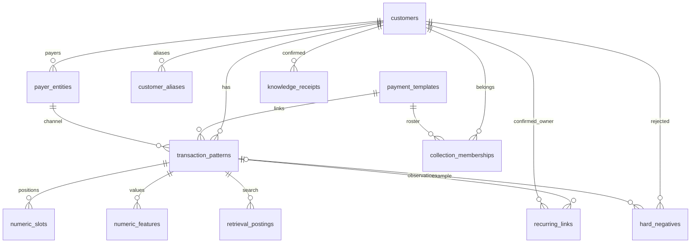

# Schema PostgreSQL của kho kiến thức

Schema hiện tại có **16 bảng**, tạo mới bằng một file [create_current.sql](../sql/create_current.sql). Backend không tự tạo/migrate. Kho cũ dùng [hướng dẫn nâng cấp đến 007](migration-and-storage.md).

## Quan hệ



Một mẫu có nhiều khách hàng; một khách hàng có nhiều mẫu. Cùng khách hàng/mẫu có thể có nhiều liên kết riêng khi định danh ổn định khác nhau. Giá trị số thuộc **liên kết**, không thuộc chung mọi khách hàng của mẫu. `collection_memberships` dành cho danh sách thu hộ tổng hợp không có nội dung riêng của từng khách hàng.

## Danh mục bảng

| Bảng | Dữ liệu/chìa khóa chính |
| --- | --- |
| `bank_aliases` | Bí danh ngân hàng/kênh trùng chính xác, kênh chuẩn, ghi chú và thời điểm đã dùng để học. Không regex hoặc ghi đè kênh cũ. |
| `knowledge_changes` | Nhật ký chỉnh kiến thức: actor/action/entity, snapshot trước/sau, khả năng hoàn tác, liên kết undo, thời điểm. Không lưu kết quả lọc. |
| `customers` | `id` (PK, mã 6 số theo ứng dụng), `canonical_name`, `normalized_name`. |
| `customer_aliases` | Tên/bí danh, bản chuẩn hóa, confidence; UNIQUE(customer_id, normalized_alias). |
| `payer_entities` | Tên ngân hàng/kênh hoặc tài khoản/thẻ từng trả, loại, confidence/count/thời gian; UNIQUE(customer_id, payer_name). |
| `payment_templates` | Bố cục chữ đã che tên phù hợp, cấu trúc, `channel_key`, fingerprint, tên/ghi chú quản lý, loại/đơn vị thu hộ mặc định, thống kê quyết toán lớn. |
| `transaction_patterns` | FK khách hàng/mẫu/người trả tiền; ví dụ gốc, nguồn, vector, số có thứ tự, fingerprint, kênh, phiên bản trích xuất, nhãn chẩn đoán, loại thanh toán riêng và thống kê gặp. UNIQUE(customer_id, fingerprint). |
| `recurring_links` | Ví dụ nội dung ổn định đã xác nhận, FK pattern/khách hàng, kênh, chữ và số có thứ tự, digest, nguồn, lần gặp. UNIQUE(pattern_id, signature_hash); index(channel_key, signature_hash). Giữ mọi biến thể đã học, tra toàn bộ chủ sở hữu trước khi giới hạn gợi ý. |
| `collection_memberships` | FK mẫu/khách hàng, số lần gặp và lần gần nhất; UNIQUE(template_id, customer_id). Không chứa vector/số của một người. |
| `numeric_slots` | Vị trí trong một liên kết, confidence/count/last_period; UNIQUE(pattern_id, slot_index). |
| `numeric_features` | Giá trị nguyên chuỗi TEXT, SHA-256, vai trò, confidence/count/missing_count theo slot; UNIQUE(pattern_id, slot_index, value_digest). |
| `retrieval_postings` | Token tìm kiếm TEXT, SHA-256, pattern_id, trọng số; UNIQUE(token_digest, pattern_id). |
| `customer_id_slots` | Ngữ cảnh số theo ngân hàng, hits/total/ví dụ; UNIQUE(channel_key, context). CHECK 0 <= hits <= total. |
| `hard_negatives` | Cặp dấu nội dung/khách hàng đã bị từ chối (nội dung chuẩn hóa và chữ ký ổn định theo kênh), pattern_id có thể NULL, count; UNIQUE(transaction_fingerprint, customer_id). |
| `knowledge_receipts` | Fingerprint chống học lặp, customer_id, tháng học từ ngày giao dịch. Không lưu kết quả đối soát. |
| `knowledge_metadata` | Phiên bản encoder/extractor, trạng thái nhập, phiên bản thống kê ID slots và trạng thái bảo trì. |

## Các trường quan trọng

`payment_templates.fingerprint` là SHA-256 của **kênh + shared shape + structure**. Cùng chữ ở hai ngân hàng không mặc nhiên chung quy tắc vị trí. `payment_mode` gồm `unknown`, `proxy`, `self`; `provider_kind` gồm `unknown`, `bank`, `wallet`, `other`. `provider_name` là tên đơn vị, không phải khách hàng.

`transaction_patterns.fingerprint` gồm **kênh + template + structure + chuỗi định danh ổn định có thứ tự**. Tham chiếu có thể biến đổi trong cùng liên kết; số riêng khác có thể tạo liên kết khác. `normalizer_version` cho biết phiên bản đã tạo slots/vector. `label_metadata` lưu `mentioned_customer_ids`, `explicit_ids_agree`, `multiple_mentions`; đây là dữ liệu giải thích, không phải điều kiện chặn nhãn đã duyệt.

Ví dụ học `IDKH=001234`, nội dung `TT KH:005678 tiền nước kỳ 08/2026`: liên kết thuộc `001234`, chẩn đoán ghi mã được nhắc `005678` và không đồng ý nhãn. Không tạo posting `id:005678` trỏ tới `001234`. Khi đối soát đúng nội dung này, yêu cầu duyệt vì nhãn lịch sử và mã được nhắc khác nhau.

`segments` JSONB lưu theo thứ tự:

```json
{"type":"number","slot":1,"numeric_type":"CONTRACT_ID","value":"001234","raw_value":"001234","format":"#","context":"hd : _ tien #6","confirmed_customer_value":true}
```

Các trường offset/anchor/position được lưu thêm khi có. Một số HD sáu chữ số có thể được xác nhận là mã của khách hàng mà vẫn bảo toàn vai trò gốc; context theo ngân hàng và chủ sở hữu giúp phân biệt. Ngày/kỳ có thể tồn tại như segment bị loại khỏi đối sánh, không thành numeric slot hoặc bằng chứng định danh.

`last_period` là tháng giao dịch dùng để cập nhật độ lặp, **không phải kỳ hóa đơn nước**. `raw_example` là ví dụ đã duyệt để giải thích và phục hồi chỉ mục; không lưu mọi giao dịch đối soát.

## Chỉ mục và giới hạn

PostgreSQL dùng pgvector `vector(384)` với HNSW/cosine; GIN trigram cho tên/alias/template và GIN full-text `simple` cho template. Posting và numeric feature dùng digest để tránh giới hạn B-tree với chuỗi dài; truy vấn kiểm tra cả digest và chuỗi gốc.

FK/UNIQUE bảo vệ quan hệ; các mã cũ vẫn dùng VARCHAR(100) để nâng cấp tương thích, nhưng mọi đường nhập/sửa hồ sơ mới kiểm tra sáu số tại ứng dụng. Công cụ reindex khôi phục số 0 đầu cho nhãn cũ hợp lệ. Không tự cắt mã dài hay sửa dữ liệu nguồn bị Excel làm tròn.

Phần lớn default do SQLAlchemy cấp khi ghi; SQL standalone không phải bộ INSERT mẫu. Nếu ghi SQL thủ công, phải cung cấp các trường NOT NULL không có server default và giữ cùng quy tắc nghiệp vụ.

## Không lưu lịch sử đối soát trong database

Kết quả, kỳ thanh toán, báo cáo lỗi riêng dòng, tác vụ và thao tác duyệt nằm trong `runtime/working/` bằng JSON/JSONL. PostgreSQL chỉ lưu kiến thức, ví dụ đã xác nhận, thống kê và receipt. Cache embedding hoặc SQLite tạm khi đọc Excel không thay PostgreSQL và không là kho lịch sử nghiệp vụ.

UI cho xem mọi bảng ứng dụng, tìm kiếm/phân trang/chi tiết. Được thêm/sửa/xóa khách hàng và liên kết mẫu; chỉnh tên/ghi chú/loại mẫu giao dịch; xem/xóa thành viên thu hộ. Các bảng slots/postings/receipt hỗ trợ chỉ xem. Xóa khách hàng dọn liên kết/số/receipt/bí danh thuộc người đó; xóa liên kết không xóa mẫu chung còn dùng bởi người khác. Nhập lại tệp đã duyệt có thể khôi phục kiến thức vừa xóa.

Quản trị có thể xác nhận/xóa bí danh khách hàng, thêm bí danh ngân hàng, gỡ chặn cách ghép và xem/hoàn tác thay đổi đủ điều kiện. Xem [cơ chế tương tác](interactive-knowledge.md) về revision, audit, namespace và giới hạn quyền.

## Bộ nhớ nội dung đã xác nhận

`recurring_links` giữ cả A–B của nội dung cũ và A của nội dung mới cụ thể hơn. Học thêm không thay thế liên kết cũ. Bảng này chứa ví dụ kiến thức đã duyệt, không chứa các dòng đối soát chưa xác nhận. UI “Nội dung đã xác nhận” chỉ xem; sửa/xóa qua liên kết mẫu có xác nhận và nhật ký. Xem [quy tắc nhận lại và giới hạn](recurring-recognition.md).

Kết quả tên/entity của ví dụ đã duyệt lưu tại `recurring_links.signature.name_extraction` (JSONB). Các offset luôn ứng với `raw_example` của bản ghi; entity không thay đổi chữ ký tra cứu. Lưu mẫu tự trả không yêu cầu ID xuất hiện trong nội dung và không phụ thuộc việc NER có tìm thấy tên hay không. Không cần migration cho trường JSON này.
