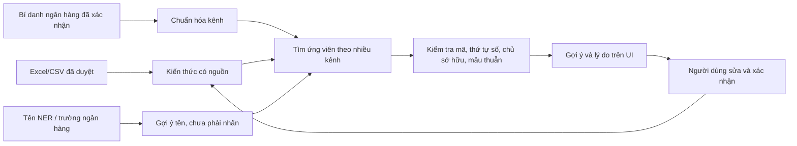

# Kiến thức tương tác và kết hợp nhiều nguồn

## Mục tiêu và phạm vi hiện tại

Đây là hệ thống gợi ý có con người xác nhận: tìm các khách hàng có liên quan, giải thích căn cứ, nhận sửa đổi rồi cập nhật kiến thức cho những lần sau. Không huấn luyện một mô hình xếp hạng từ các cú click chưa xác nhận. Một lựa chọn gợi ý hoặc một lần xem không phải nhãn đúng.

Phiên bản này dành cho một nhóm quản trị nội bộ. Tài khoản quản trị dùng chung được cấu hình bên ngoài PostgreSQL; nhật ký phân biệt tài khoản cấu hình và chế độ cục bộ. Chưa có tài khoản riêng từng nhân viên, SSO hay phân quyền xem/duyệt/quản trị. Nếu cần nhiều người dùng có trách nhiệm riêng, triển khai giai đoạn phân quyền bên dưới trước khi mở rộng quyền sửa.

## Những gì người dùng làm được

| Thao tác trên UI | Kiến thức thay đổi | Tác dụng và giới hạn |
| --- | --- | --- |
| Xác nhận/sửa khách hàng ở dòng đối soát | Hồ sơ, liên kết mẫu, số, chỉ mục, receipt | Học ngay trong transaction. Có thể xác nhận nhiều IDKH; không tự chia tiền. |
| Nhập Excel/CSV đã duyệt | Toàn bộ kiến thức nghiệp vụ của các dòng hợp lệ | Dùng nhãn đã duyệt, kể cả không có IDKH trong nội dung; không biến suy đoán parser thành điều kiện chặn học. |
| Thêm/sửa tên khách hàng | Tên chính và bí danh | Tên chính không bị NER tự ghi đè. IDKH vẫn là sáu số. |
| **Thêm bí danh khách hàng** | `customer_aliases`, khóa tìm tên | Xác nhận tên thực hoặc cách ghi khác. Bí danh từ NER có thể được duyệt lên mức tin cậy 1. Một tên có thể thuộc nhiều IDKH; hệ thống kiểm tra chủ sở hữu toàn kho. |
| Xóa bí danh | Bí danh và khóa tìm tên của khách hàng | Không cho xóa tên chính; đổi tên chính trước. Có thể hoàn tác nếu không xung đột. |
| **Thêm bí danh ngân hàng / ví** | `bank_aliases` | Ánh xạ tên sheet/cột ngân hàng trùng chính xác về kênh chuẩn. Không dùng regex hay nhận diện theo chuỗi con. Có hiệu lực cho học và đối soát mới. |
| Gán Thu hộ / Tự trả | Mẫu hoặc liên kết được chọn | Có thể áp dụng cho toàn bộ mẫu đang tìm/lọc, kể cả các trang khác. Không thay đổi IDKH hay số tiền. |
| Sửa nội dung hoặc khách hàng của liên kết | Ví dụ đã duyệt và toàn bộ đặc trưng dẫn xuất | Dựng lại số, embedding và postings; không sửa trực tiếp vector/hash/trọng số. |
| Thêm một cách ghi mới | Liên kết mới của khách hàng | Giữ các cách ghi cũ; một khách hàng có nhiều mẫu. |
| Xóa khách hàng, liên kết hoặc thành viên thu hộ | Dữ liệu liên quan được chỉ rõ | Có xác nhận; không xóa mẫu vẫn có liên kết. Nhập lại nguồn đã duyệt có thể tạo lại kiến thức vừa xóa. |
| **Gỡ chặn cách ghép sai** | Một `hard_negatives` cụ thể | Cho phép xét lại nếu lần từ chối trước sai; không tự xác nhận cách ghép đó. |
| **Nhật ký thay đổi → Hoàn tác** | Bí danh khách hàng hoặc bí danh ngân hàng chưa dùng | Chỉ các thao tác đủ điều kiện; backend kiểm tra trạng thái hiện tại. Thao tác lớn sửa lại qua bản ghi liên quan hoặc phục hồi backup. |

Các nút mới nằm trong **Quản lý kiến thức**. Hồ sơ khách hàng có nút thêm/xem bí danh. Nhóm **Tên / bí danh khách hàng** có xác nhận/xóa. Nhóm **Ghép sai đã bị từ chối** có gỡ chặn. Mọi bảng hỗ trợ vẫn xem được, nhưng không có API ghi bảng/SQL tùy ý.

## Kết hợp nguồn mà không đếm lặp bằng chứng

Các nguồn có vai trò riêng:

1. **Nhãn đã duyệt** xác nhận liên kết giao dịch với khách hàng. Nhãn Excel/CSV và xác nhận thủ công đều có giá trị nghiệp vụ; không giới hạn học chỉ vì nội dung có mã khác hoặc nhiều mã.
2. **Mã số và context ngân hàng** giúp xác định người. Giữ đầy đủ giá trị, thứ tự, vai trò; không cắt dãy dài thành IDKH. HD sáu số có thể là IDKH trong một bố cục đã học, không mặc định mọi HD là IDKH.
3. **Tên/bí danh** bổ sung đường tìm ứng viên. NER là đề xuất; bí danh do người dùng duyệt có độ tin cậy cao hơn. Tên trùng vẫn phải giữ nhiều chủ sở hữu.
4. **Tài khoản người trả** có thể liên quan nhiều khách hàng. Ngân hàng/ví hoặc tài khoản trung gian không chứng minh một khách hàng duy nhất.
5. **Bố cục và ngữ nghĩa** mở rộng tập ứng viên khi cách ghi thay đổi; mẫu ngân hàng chung có thể thuộc rất nhiều người. Những tín hiệu này không vượt qua mâu thuẫn định danh.
6. **Roster thu hộ** là danh sách từng liên quan đến mẫu, không phải bảng kê người được trả lần hiện tại.
7. **Phản hồi sai** chặn đúng cặp nội dung/khách hàng. Xác nhận tích cực sau đó hoặc thao tác gỡ chặn có kiểm soát có thể cho xét lại.

Retrieval dùng RRF có trọng số và hạn mức đa dạng khách hàng. `retrieval_source_families` gom các đường tìm vào identifier, approved_history, payer_account, customer_name, layout, text_similarity. Semantic, trigram và full-text trên cùng nội dung không được coi là ba xác nhận độc lập. Số RRF chỉ chọn ứng viên; điểm hiển thị là điểm quy tắc nghiệp vụ, **chưa phải xác suất được hiệu chỉnh thống kê**.

Khi nguồn mâu thuẫn, giữ đề xuất có liên quan và lý do để người dùng duyệt. Không tự giải quyết bằng đa số các kênh tìm kiếm. Khách hàng chưa có trong kiến thức vẫn 0% và kiểm tra thủ công; có thể hiển thị mã được nhắc và các đề xuất liên quan. Không có thông tin liên quan thì để trống.

Khi chỉ có thông tin bối cảnh, vẫn cung cấp [nhóm khách hàng cần kiểm tra](contextual-recommendations.md) theo ngân hàng/mẫu/tên và đặc điểm thiếu ID trong lịch sử. Đây là phạm vi để duyệt, không phải xác nhận một người hay bảng kê thanh toán hiện tại.

`channel_resolution` ghi tên kênh đầu vào, kênh chuẩn và việc dùng bí danh đã xác nhận. Ví dụ `Ngân hàng Đầu tư Huế` được admin ánh xạ về `bidv`: số/context/mẫu mới nằm trong cùng namespace BIDV, không tạo một ngân hàng mới theo tên sheet.

## Schema và nhất quán

Migration 006 thêm hai bảng (schema hiện tại qua 007 có 16 bảng):

- `bank_aliases`: `alias`, `normalized_alias` UNIQUE, `channel_key`, `note`, `used_at`. Chỉ nhận các kênh chuẩn được hỗ trợ; không nối alias→alias. Không ghi đè một tên ngân hàng đã nhận diện sang ngân hàng khác. Nếu namespace cũ đã có mẫu, yêu cầu chuyển dữ liệu/dựng lại chỉ mục trong đợt bảo trì thay vì âm thầm đổi khóa.
- `knowledge_changes`: `actor`, `action`, `entity_key`, `before`, `after`, `reversible`, `reverted_by`, `created_at`. Nhật ký của **kiến thức**, không lưu các dòng kết quả đối soát. Các ví dụ giao dịch chỉ xuất hiện khi chính ví dụ kiến thức được thêm/sửa/xóa. Nhập tệp lưu tên/count; xác nhận dòng lưu tập IDKH và thao tác, không sao chép lịch sử lọc vào bảng audit.

`knowledge_metadata.interactive_revision` đổi khi học hoặc chỉnh kiến thức. UI giữ revision lúc mở bản ghi; API yêu cầu `If-Match` cho thao tác quản trị. Mất header trả 428; dữ liệu đã đổi trả 409. Một form cũ không được dùng revision mới của một panel khác để ghi đè. Import bị dừng sau vài batch vẫn làm form cũ hết hiệu lực.

Cập nhật hàng loạt kiểm tra cả số lượng và SHA-256 của **ID + nhãn + liên kết thực tế** trong phạm vi. Hai danh sách có cùng số dòng nhưng khác đối tượng không được coi là một phạm vi. Kiểm tra, sửa dữ liệu và ghi audit nằm trong cùng transaction; lỗi rollback toàn bộ thao tác. PostgreSQL advisory lock và khóa tác vụ hiện có vẫn áp dụng.

Hoàn tác chỉ hỗ trợ bí danh khách hàng và bí danh ngân hàng vừa thêm. Kiểm tra snapshot, thay đổi mới hơn, trùng bí danh, tên chính hiện tại và quan hệ đã dùng. `used_at` được gắn ngay khi học qua bí danh ngân hàng, kể cả học roster gọn; sau đó không gỡ alias bằng undo. Không hứa hoàn tác tự động các thao tác xóa nhiều bảng hoặc thay nhãn toàn kho: cần kiểm tra nghiệp vụ và backup.

Tài khoản `invoice_app` chỉ được SELECT/INSERT nhật ký và UPDATE cột `reverted_by`; script thu hồi UPDATE/DELETE toàn bảng audit. Đây là audit ở mức ứng dụng/role DB, không chống người sở hữu database hoặc người giữ mật khẩu quản trị DB sửa trực tiếp.

## Ranh giới truy cập

- Chưa cấu hình tài khoản: chỉ cho client và Host loopback trực tiếp; từ chối truy cập ngoài máy và các header proxy. Chế độ này dùng phát triển/cục bộ.
- Để dùng chung: đặt **cả** `APP_ADMIN_USER` và `APP_ADMIN_PASSWORD` (ít nhất 16 ký tự), khởi động lại. Trình duyệt hỏi tài khoản bằng HTTP Basic; tất cả UI/API/export đều được bảo vệ. Không ghi mật khẩu vào DB, URL, audit hoặc localStorage. Giới hạn 10 lần đăng nhập sai/IP/phút, bộ nhớ giới hạn 1.024 IP trong một worker.
- Dùng HTTPS qua reverse proxy khi truy cập mạng: HTTP Basic không mã hóa mật khẩu trên đường truyền HTTP. Giữ backend trên loopback và chỉ tin proxy đã cấu hình. Không dùng chế độ local-only để bảo vệ một backend được proxy chuyển tiếp.
- Thao tác trình duyệt khác origin bị từ chối; kiểm tra `Origin`/`Sec-Fetch-Site`. CSP chỉ chạy script cùng origin; không iframe; `nosniff`; API/dữ liệu không cache. Không cấp CORS tùy ý. Schema API tại `/openapi.json` được bảo vệ cùng tài khoản; tắt Swagger/ReDoc phụ thuộc script CDN để giữ chính sách script cùng origin.
- Input có trường cho phép và giới hạn độ dài; trường thừa bị từ chối. ORM truy vấn tham số hóa, tìm kiếm escape ký tự wildcard, tên bảng thuộc registry cố định. Không có chức năng chạy SQL, regex, Python, đổi trọng số hay sửa vector qua UI.
- Route mẫu phát triển/benchmark web tắt mặc định. Chỉ bật `ENABLE_DEV_ROUTES=true` trong môi trường phát triển; vẫn yêu cầu cùng quyền truy cập. Benchmark nên chạy bằng CLI trên kho riêng.
- Dùng role PostgreSQL nghiệp vụ, không chạy web bằng superuser/owner. Backup định kỳ vẫn cần thiết; audit không thay backup.

Giới hạn hiện tại: một tài khoản quản trị chung không truy ra cá nhân; không có MFA, SSO, session timeout theo người hoặc quy trình hai người duyệt. Không đưa phiên bản này trực tiếp lên Internet như một hệ thống nhiều vai trò.

## Kế hoạch mở rộng theo thứ tự

| Giai đoạn | Công việc | Điều kiện đưa vào sử dụng |
| --- | --- | --- |
| **Đã làm** | Bí danh, sửa kiến thức, loại thanh toán, phản hồi, nhật ký, version/undo có giới hạn, ranh giới đăng nhập | Kiểm tra bảo mật và benchmark tách nguồn học/test; SQL do quản trị tự chạy. |
| 2 · Nguồn tham chiếu | Import danh bộ khách hàng riêng; registry ngân hàng/kênh; nguồn bảng kê thu hộ; hồ sơ nguồn với thời điểm/độ ưu tiên | Ghép bằng khóa chính, preview khác biệt; không ghi đè tên hoặc liên kết đã xác nhận bằng tên payer/NER. |
| 3 · Nhiều người dùng | SSO/OIDC, quyền xem/đối soát/quản trị, người duyệt khác người đề xuất với thay đổi diện rộng | Định danh cá nhân, audit, khóa phiên, kiểm tra quyền từng endpoint/đối tượng. |
| 4 · Đề xuất cải thiện kiến thức | Hàng chờ tên NER chưa duyệt, kênh chưa nhận diện, mẫu có phản hồi trái chiều, ngữ cảnh số mới | Đề xuất có ví dụ/nguồn; lưu thay đổi chỉ sau xác nhận; ưu tiên bất định và tác động, không chỉ số lần xuất hiện. |
| 5 · Hiệu chỉnh xếp hạng | Ranker/hiệu chỉnh điểm từ các nhãn đã duyệt, đo theo ngân hàng/self/proxy/multi/unknown | Holdout theo thời gian và nhóm chuyển tiền; không rò rỉ nhãn test; giới hạn precision với khoảng tin cậy trước khi tăng auto_accept. |
| 6 · Thay quy tắc/namespace lớn | Sandbox preview, impact report, bản phát hành kiến thức, rollback phiên bản | Không cho nhập regex tự do vào production; đo precision/recall/latency và xác nhận phạm vi chuyển dữ liệu. |

## Cài SQL và kiểm chứng

Database mới: chỉ [sql/create_current.sql](../sql/create_current.sql). Kho đang ở v7/005: tự chạy [006_interactive_knowledge.sql](../sql/migrations/006_interactive_knowledge.sql); không cần reindex chỉ vì thêm 006. Bản hiện tại cần thêm 007 và bộ nhớ nội dung đã xác nhận; kho cũ hơn chạy đủ 005, 006, 007 trước reindex. Xem [nâng cấp](migration-and-storage.md).

Benchmark dùng SQLite mới riêng, embedding E5 đã cache, tệp lịch sử để học và tệp kỳ sau chỉ để đánh giá. Không đọc `.env`, không chạm PostgreSQL. Báo cáo và giới hạn phép đo ở [interactive-benchmark.md](interactive-benchmark.md). Không dùng precision của vài chục kết quả đúng để khẳng định precision toàn bộ vận hành.

Khách hàng chỉ có trong registry/roster, chưa có mẫu thanh toán riêng phù hợp, được gợi ý với điểm thấp và yêu cầu duyệt; không tự ghép chỉ vì IDKH có tồn tại. Xác nhận của người dùng bổ sung mẫu riêng để lần sau có căn cứ đối chiếu.

Bảng `recurring_links` hiển thị dưới tên **Nội dung đã xác nhận**, cho xem/tìm kiếm ví dụ kiến thức. Không có API sửa trực tiếp chữ ký để tránh tạo bằng chứng giả. Xóa/sửa liên kết mẫu là thao tác nghiệp vụ có xác nhận; học thêm giữ các ví dụ cũ. Xem [nhận lại mẫu](recurring-recognition.md).
