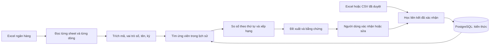

# Tìm kiếm, so khớp và học kiến thức

Tài liệu này mô tả phiên bản `rules-v7-confirmed-evidence`. Các tệp trong `Data/` phục vụ rà soát/đánh giá; luồng sử dụng không phụ thuộc tháng hoặc ngân hàng cụ thể. Điểm hiển thị là điểm bằng chứng, không phải xác suất đã hiệu chuẩn. Kết quả và giới hạn phép đo ở [báo cáo benchmark](interactive-benchmark.md).

## 1. Hai luồng và nguồn sự thật

**Học:** Excel/CSV đã duyệt hoặc thao tác **Xác nhận & học** cung cấp IDKH đúng. Hệ thống kiểm tra mã, nội dung và số tiền, rồi lưu quan hệ đã xác nhận. Không từ chối chỉ vì nội dung nhắc mã khác, nhiều mã hoặc không có mã. Không tự coi mọi mã được nhắc đến là người được thanh toán.

**Đối soát:** chỉ đọc kiến thức để đề xuất. Kết quả, kỳ hóa đơn và trạng thái duyệt lưu ngoài PostgreSQL. Chọn checkbox chưa học; bấm xác nhận hoặc nhập tệp đã duyệt mới học. Không dùng nhãn của tệp đánh giá để tìm ứng viên.



## 2. Mã khách hàng và bảo toàn số

IDKH của công ty gồm **đúng 6 chữ số**, giữ số 0 đầu. Bộ đọc nội dung không cắt tài khoản/tham chiếu dài thành các mã 6 số. Trong cột đã xác nhận, giá trị số Excel `1234` hoặc `1234.0` được khôi phục thành `001234`; chỉ áp dụng cho nhãn do người dùng cung cấp. Chuỗi dài hơn sáu số không được tự sửa.

Nhãn trong nội dung gồm `Ma KH`, `Mã khách hàng`, `IDKH`, `MSKH`, `MKH`, `KH`, danh bộ và một số biến thể có dấu cách, gạch ngang, gạch dưới, dấu hai chấm hoặc ghi liền. Danh sách có dấu phân cách được đọc thành các mã riêng, theo thứ tự xuất hiện. Ví dụ:

```text
TTHD Tien nuoc Ma KH-279021 Ma HD-Ky 8/2026
TT tiền nước IDKH:001234,005678 kỳ 082026
```

Ví dụ đầu có IDKH `279021` và kỳ `08/2026`; `Ma HD-Ky` không tạo hợp đồng giả. Ví dụ sau có hai mã được nhắc đến; đối soát yêu cầu người dùng xác nhận người thực sự được thanh toán.

Mỗi số giữ `value`, `raw_value`, `numeric_type`, vị trí `slot`, offset, anchor, định dạng và ngữ cảnh cục bộ. Mã chữ/số giữ toàn bộ chuỗi. `HD` thường là hợp đồng, nhưng mã sáu số tại vị trí HD có thể là IDKH trong bố cục thu hộ đã học. `TKThe` là thẻ người trả tiền; không biến nó thành IDKH. Tài khoản nhận của công ty, protocol và tham chiếu ngân hàng không làm bằng chứng khách hàng.

Các bố cục cụ thể được đọc khi có dấu hiệu đủ rõ: BIDV O@L, MB với trường ngày giờ/đơn vị nhận/mã/tham chiếu/kỳ/tên, Agribank `MA_GD:...|IDKH,Nuoc...`, và các trường mã trong một số nội dung SCB/ABB. Ngoài các trường đã nhận diện, số chưa rõ vai trò được giữ nguyên để so với ví dụ đã xác nhận.

Ngân hàng/kênh được chuẩn hóa thành `channel_key`; tên sheet như VCB và Vietcombank cùng kênh, các sheet phụ có số không tạo một ngân hàng mới. Trong bộ dữ liệu hiện tại, nhãn SCB được quy về Sacombank; cần đổi bảng ánh xạ trong `app/identifiers.py` nếu nguồn triển khai dùng SCB cho ngân hàng khác. Không suy rằng mọi chuyển khoản từ một ngân hàng đều là thu hộ.

## 3. Học từ nhãn đã duyệt

1. Đọc mọi sheet có bố cục học hợp lệ; `ko` bỏ qua. Nhãn chưa phân giải không tạo khách hàng giả.
2. Kiểm tra IDKH hợp lệ và số tiền hữu hạn, không âm. Lỗi một dòng được ghi theo sheet/dòng; các dòng khác tiếp tục bằng savepoint.
3. Tạo/cập nhật hồ sơ. Tên đã xác nhận là tên/bí danh đáng tin; thiếu tên có thể dùng IDKH làm tên tạm và sửa sau.
4. Trích nội dung, bỏ ngày/kỳ khỏi đặc trưng. Nhãn IDKH được tin cậy dù khác mã trong nội dung. `label_metadata` giữ thông tin khác biệt để giải thích khi đối soát.
5. Tìm/tạo mẫu giao dịch theo ngân hàng, dạng chữ đã che tên và cấu trúc số. Tìm/tạo liên kết riêng của khách hàng theo ngân hàng, template, structure và chuỗi định danh ổn định.
6. Đánh dấu một số là mã của khách hàng **chỉ khi toàn bộ giá trị sáu số trùng IDKH đã xác nhận** và vai trò cho phép. Các mã khác không trở thành mã sở hữu của người này. Khi đối soát nội dung có nhiều mã và đúng nội dung đó đã được duyệt trước đây, danh sách đề xuất lấy người nhận đã xác nhận trong lịch sử; vẫn yêu cầu kiểm tra thủ công và giữ riêng danh sách mã được nhắc đến.
7. Cập nhật giá trị theo đúng slot, alias, tài khoản trả tiền, embedding và các khóa tìm kiếm. Receipt ngăn tăng số lần học khi nộp lại cùng giao dịch/khách hàng.
8. Sau nhập, đếm lại các vị trí IDKH từ toàn kho đã xác nhận theo từng ngân hàng. Khi một liên kết mới làm thay đổi ngữ cảnh, quy tắc tổng hợp tại ngữ cảnh đó được vô hiệu hóa trước khi đếm lại.

**Nhiều khách hàng:** có thể lặp lại nội dung trên nhiều dòng, mỗi dòng một IDKH/tên, hoặc ghi danh sách mã phân cách trong một ô IDKH. Mỗi mã được xác nhận tạo liên kết riêng; không chia số tiền. Nếu nhập nhiều tên trong cùng ô, dùng dấu chấm phẩy theo cùng thứ tự IDKH. Khi không có đủ tên tương ứng, không gắn một tên chung cho tất cả; giữ tên đã có hoặc tên tạm.

**NER và bí danh:** dùng `NlpHUST/ner-vietnamese-electra-base`; đọc trường tên MB/Agribank trước khi dựa vào NER. Tên tự trích chỉ thêm làm alias khi có một tên rõ, không có nhiều mã được nhắc đến và không có mâu thuẫn với IDKH đã duyệt. Danh sách nhiều IDKH được xác nhận cùng lúc cũng không dùng một tên NER cho tất cả. Alias tự trích có độ tin cậy dưới 1; tên người dùng xác nhận có độ tin cậy 1. Tên chỉ giúp tìm ứng viên, không tự chứng minh một đồng hồ/khách hàng. Không tự sửa dấu tiếng Việt hoặc thay tên chuẩn bằng NER. NER lỗi thì tiếp tục bằng các trường có cấu trúc và quy tắc số.

**Khách hàng tự chuyển khoản, nội dung không có ID:** vẫn học bình thường theo IDKH đã duyệt trong tệp hoặc lúc xác nhận. Thiếu ID, NER không có kết quả hoặc có nhiều entity đều không chặn lưu mẫu. Kết quả NER (entity, vị trí trong nội dung gốc, loại, điểm, nguồn và phiên bản mô hình) được lưu trong `recurring_links.signature.name_extraction`, gắn với đúng `raw_example`; không tham gia hash định danh. Một tên rõ có thể bổ sung bí danh; nhiều tên vẫn lưu làm bằng chứng của mẫu, không tự gán tất cả thành tên của cùng khách hàng. Nhập lại có thể bổ sung entity cho ví dụ cũ mà không tăng lần học; NER bị tắt/lỗi không xóa entity đã lưu. Nhãn tự trả đã xác nhận được ưu tiên hơn dấu hiệu thu hộ chung khi nhận lại mẫu riêng. Khi nội dung thuộc nhiều khách hàng, vẫn giữ nhóm và yêu cầu duyệt.

**Đối soát dựa vào tên:** khi không có IDKH và không có định danh riêng đủ tin cậy (hợp đồng, mã/số riêng đã xác nhận), nhánh so khớp gần đúng chỉ được tự ghép nếu các entity tên đầy đủ trong giao dịch và mẫu lịch sử giống nhau. Bỏ khác biệt hoa/thường, dấu tiếng Việt và khoảng trắng; giữ toàn bộ từ và thứ tự trong từng tên. `NGUYEN THI THUY` khác `NGUYEN THI KIM THUY`, kể cả cùng tài khoản gửi tiền hoặc embedding giống hoàn toàn. Nhiều entity phải khớp cả tập, không chỉ một tên chung. Thiếu tên ở một phía hoặc có khác biệt thì yêu cầu duyệt, kèm `name_entity_comparison` và hai tên trên giao diện. So với entity của đúng nội dung đã học, không thay bằng tên chủ hồ sơ hoặc một bí danh khác.

Quan sát trùng chính xác nội dung ổn định vẫn được nhận lại khi NER không sẵn sàng, vì khóa tra cứu giữ toàn bộ từ của tên; không có bước so tên gần đúng ở nhánh này. Nếu cả hai phía có entity nhưng khác nhau, nhánh tra trực tiếp cũng yêu cầu duyệt. Người dùng vẫn có thể xác nhận và học các tên người trả khác nhau cho cùng khách hàng. Kết quả đối soát đã lưu giữ nguyên; chạy đối soát lại để áp dụng quy tắc mới.

## 4. Vị trí IDKH học theo ngân hàng

`customer_id_slots` lưu `(channel_key, context, hits, total)`. Context gồm hai đơn vị trước, một đơn vị sau và độ dài số; tên người không quyết định context. Ví dụ trường `JSC.<ID>.` khác trường tham chiếu đứng trước ngày giờ.

Hệ thống nhóm các liên kết cùng nội dung/ngân hàng, lấy tập IDKH được duyệt. Một số là hit nếu trùng một thành viên của tập. Với nhiều khách hàng, không coi các mã của đồng thanh toán là lỗi. Khoản quyết toán lớn không dùng để suy vị trí IDKH.

Dùng khoảng Wilson 95%: cận dưới >=0,95 mới nhận là vị trí IDKH; cận trên <=0,05 mới coi là vị trí không phải IDKH; còn lại chưa rõ. Cần khoảng 73 ví dụ sạch hoàn toàn để một vị trí vượt cận dưới 0,95. Không biến một lần trùng ngẫu nhiên thành quy tắc chung. Những số ở vị trí đã chứng minh không phải IDKH không tạo ràng buộc sở hữu; nhãn rõ nhưng bị lịch sử phản bác cần duyệt.

Các liên kết vừa xác nhận có khóa `slot-id` dùng ngay, không phải chờ đủ mẫu cho quy tắc tổng hợp. Sau xác nhận đơn lẻ, các quy tắc tổng hợp liên quan có thể tạm vắng cho tới lần nhập/đếm lại; đây là lựa chọn bảo thủ để tránh dùng quy tắc cũ sai.

### Vị trí tên và tìm theo giá trị đã xác nhận

Tệp FN cho biết tên thật của khách hàng, nên hệ thống tìm tên đó trong nội dung (bỏ dấu, chữ thường, khớp trọn tên ≥ 2 từ) để biết **vị trí**. `customer_name_slots` lưu `(channel_key, context, hits, total, boundaries)`: context là hai đơn vị đứng trước tên (ví dụ `N10 ;` cho `BIDV;5510000370;<tên> chuyen tien`), `boundaries` là đơn vị kết thúc tên (`.`, `;`, `tra`…). Một vị trí là trường tên khi có ≥ 20 lần và cận dưới Wilson ≥ 0,6 (người trả đôi khi ghi tên chính mình — vẫn là tên). Bảng được đếm lại cùng vị trí IDKH sau mỗi lần nhập hoặc `scripts/reindex_knowledge.py`.

Khi đối soát, nếu NER không đọc được tên:

1. đọc tên ở vị trí đã học của ngân hàng/kênh (`learned_name_position`);
2. so với mẫu lịch sử: tên NER đã lưu → tên đã xác nhận của khách hàng tìm thấy trong mẫu (`confirmed_name`) → tên ở vị trí đã học;
3. tên vẫn được so **trọn vẹn**, không theo từ chung. Lý do hiển thị cả hai tên, ví dụ "giao dịch: LE THI TAM; mẫu đã học: nguyen bi".

IDKH làm tương tự: nếu quy tắc/vị trí đã học không thấy mã nhưng nội dung có **đúng một** số 6 chữ số độc lập trùng IDKH của ứng viên, không phải số tiền/thẻ/tài khoản/tham chiếu/vị trí không-phải-mã, và không mâu thuẫn vị trí mã đã xác nhận, thì coi là mã ghi trong nội dung (cần mục đích tiền nước). Nội dung không bắt buộc có IDKH; khi không có, so khớp dùng thẻ, tên, mẫu như trước.

Khi nội dung ghi đúng một IDKH, khách hàng khác chỉ được gợi ý nhờ tài khoản/tên/số trùng sẽ bị hạ điểm, ghi chú "Khác mã … ghi trong nội dung" và không bao giờ thành khách hàng của dòng.

## 5. Một khách hàng có nhiều mẫu

`payment_templates` lưu bố cục chung; `transaction_patterns` là các liên kết có ví dụ, số và lịch sử riêng. Một khách hàng có nhiều liên kết, một mẫu có nhiều khách hàng.

Không dùng quy tắc đơn giản “chữ giống 90% thì ghi đè”. Khi học, fingerprint gồm kênh, template, structure và chuỗi định danh ổn định có thứ tự. Tham chiếu/ngày thay đổi có thể cập nhật các giá trị ở slot của liên kết hiện có; hợp đồng, mã cơ sở hoặc mã chữ/số khác có thể tạo liên kết khác. Điểm tương đồng chỉ giúp tìm/so sánh, không cho phép đổi số định danh.

Một HD có thể liên kết nhiều IDKH. IDKH rõ và đã biết được ưu tiên hơn HD. HD dùng chung hoặc chỉ một mẫu chung không đủ chọn người. Nếu nội dung đã được xác nhận cho khách hàng khác với mã đang được nhắc đến, hệ thống chuyển duyệt và đưa gợi ý từ lịch sử thay vì tự chọn mã in trong nội dung.

## 6. Thu hộ tổng hợp

Các dòng liền nhau cùng nội dung có tham chiếu giao dịch riêng, kênh ví/dịch vụ thu hộ đã biết và ít nhất 10 khách hàng được lưu gọn:

- Hồ sơ/tên khách hàng và receipt.
- Một mẫu và thống kê `max_transfer_customers`, `settlement_rows`.
- `collection_memberships` liên kết mẫu với những khách hàng đã được xác nhận.

Không tạo hàng nghìn vector và bản sao số từ một nội dung tổng hợp không xác định từng người. Đối soát lại khoản tổng hợp yêu cầu bảng kê; có thể mở danh sách khách hàng liên quan (tối đa 20 gợi ý gần đây trên kết quả). Danh sách là lịch sử của mẫu, **không phải phân bổ của giao dịch hiện tại**. UI quản lý cho xem/tìm/phân trang toàn bộ danh sách.

Tổ chức tự trả nhiều đồng hồ vẫn được học liên kết đầy đủ; không tự coi mọi giao dịch nhiều khách hàng là quyết toán ví.

## 7. Retrieval: tìm ứng viên có giới hạn

Các đường tìm kiếm chạy trên kiến thức đã xác nhận:

| Đường tìm | Khóa/bằng chứng |
| --- | --- |
| IDKH | `id:<mã chuẩn>`; chỉ mã của hồ sơ đã duyệt. |
| Nội dung chính xác | `exact:<digest>` của nội dung chuẩn hóa bỏ ngày. |
| Định danh | Hợp đồng, mã khách hàng đã xác nhận, `slot-id:<digest kênh + context>:<giá trị>`. |
| Chi tiết | Mã chữ/số, chữ/số cơ sở, fingerprint chi tiết thanh toán. |
| Người trả tiền | Tài khoản/thẻ đã từng trả cho khách hàng. |
| Tên | Tên/bí danh đã học và tên NER/đọc từ trường ngân hàng. |
| Mẫu chung | Dạng mẫu và cấu trúc theo ngân hàng. |
| Văn bản/ngữ nghĩa | PostgreSQL full-text, trigram và pgvector HNSW. |

Posting tra cả SHA-256 và chuỗi gốc, không chỉ digest. Chủ sở hữu các định danh được kiểm tra trên toàn kho, không bị giới hạn bởi top ứng viên. `bound-id` hỗ trợ tìm, nhưng ràng buộc số đã học dùng thêm kênh/context để tránh một số tiền/tham chiếu tình cờ bằng IDKH làm chặn sai.

Mỗi nguồn nhóm theo mẫu trước khi giới hạn và giữ đa dạng khách hàng. Hợp nhất bằng weighted RRF `weight/(60+rank)`, ưu tiên ID/exact/identity hơn ngữ nghĩa. Dành chỗ cho các đường bằng chứng trực tiếp để mẫu ngân hàng phổ biến không lấn hết kết quả. Rerank tối đa `CANDIDATE_LIMIT` (mặc định 40) mẫu, rồi lấy mẫu tốt nhất mỗi khách hàng. Một IDKH rõ, duy nhất và đã biết có thể giới hạn tìm kiếm vào khách hàng đó sau các kiểm tra mâu thuẫn.

Embedding `intfloat/multilingual-e5-small`, 384 chiều, mặc định CPU. Giữ tiếng Việt có dấu, thay giá trị số/ngày trước khi mã hóa; số so riêng. Không dùng LLM sinh nội dung/Ollama. Cache embedding có giới hạn, tách khỏi PostgreSQL.

## 8. Rerank và các điều kiện chấp nhận

| Thành phần | Trọng số cơ sở |
| --- | --- |
| Khách hàng/định danh | 0,30 |
| Người trả tiền | 0,10 |
| Nội dung chữ/ngữ nghĩa | 0,20 |
| Cấu trúc | 0,15 |
| Số theo thứ tự | 0,15 |
| Lịch sử lặp lại | 0,10 |

Điểm cơ sở được điều chỉnh bởi bằng chứng mạnh (IDKH chính xác, hợp đồng duy nhất đúng vị trí, số đã xác nhận cùng context, mã chữ/số duy nhất). Độ giống nội dung/vector không tự cho phép ghép.

So sánh số kiểm tra vai trò, giá trị nguyên chuỗi, định dạng, thứ tự và template. Định danh bị đổi/chuyển vị trí hoặc chỉ khớp một phần phải duyệt. HD mới không thắng IDKH rõ đã biết. Với mẫu dùng chung/thu hộ, cần mã/số riêng; không ghép chỉ vì tên hoặc tài khoản trung gian. Kiểu thanh toán chưa rõ cũng cần bằng chứng định danh đủ mạnh.

Mặc định: `AUTO_THRESHOLD=0.9`, `REVIEW_THRESHOLD=0.6`, `MATCH_MARGIN=0.08`. Hai khách hàng đủ điểm và gần nhau dưới margin phải duyệt. Thay ngưỡng không bỏ qua các điều kiện mâu thuẫn định danh.

| Kết quả | Hành vi |
| --- | --- |
| `auto_accept` | Đủ điều kiện đề xuất mạnh; có thể chọn xác nhận hàng loạt. Chưa tự học. |
| `review` | Có ứng viên, cần duyệt. |
| `manual_check` | Thiếu bằng chứng/mâu thuẫn/nhiều người; vẫn có gợi ý liên quan, điểm dưới ngưỡng duyệt. |
| IDKH chưa có trong kho | Luôn thủ công 0%; có thể hiển thị mã đọc được và gợi ý liên quan riêng. |
| Không có thông tin liên quan | Để trống khách hàng, 0%. Không lấy một hàng xóm vector chung để điền tên. |
| Nhiều IDKH | Hiển thị danh sách đã biết/chưa biết, không tự chọn một người, không chia tiền. |
| Đã từ chối đúng nội dung/khách hàng | Không đề xuất lại cặp đó; vẫn có thể tìm người khác. |

Gợi ý dự phòng tìm trực tiếp mã sáu số, tài khoản, hợp đồng/context, nội dung đã xác nhận và tên/bí danh. Tra tên bằng cụm chính xác có chỉ mục trước tìm rộng. Khách hàng chỉ có trong bảng kê thu hộ cũng có thể được gợi ý khi nội dung nhắc mã/tên. Các gợi ý yếu không được xác nhận hàng loạt.

Đầu ra `candidate_group` bổ sung **nhóm cần kiểm tra** khi chưa đủ bằng chứng cá nhân: cùng ngân hàng, bố cục, tên/bí danh; thiếu IDKH được dùng có điều kiện theo lịch sử. Nhóm có tổng số, tìm kiếm và phân trang, không tự điền khách hàng đầu tiên hoặc tăng điểm tự ghép. Xem [cách tạo và dùng nhóm](contextual-recommendations.md).

## 9. Kỳ thanh toán chỉ phục vụ đối soát

Đọc từ nội dung: `kỳ 8/2026`, `KY082026`, `KY72026`, `T6N2026`, `Nuoc6/2026`, `tháng 7 năm 2026`, `07/2026` trong nội dung tiền nước, danh sách/khoảng tháng. Bố cục MB đọc trường kỳ riêng.

Ngày đầy đủ, timestamp, nhãn ngày chuyển tiền/hạn thanh toán, mã tài khoản/tham chiếu/IDKH được loại khỏi kỳ. Chỉ có tháng thì hiển thị **Tháng 08 (chưa rõ năm)**; không lấy năm ngày chuyển tiền hoặc ngày hiện tại. Khoảng tháng mở rộng tối đa 24 tháng, bỏ trùng. Nếu không có căn cứ thì để chưa xác định.

Cùng bộ dò cung cấp vùng ngày/kỳ cần che trong học. Kỳ không tạo numeric slot, không đưa vào embedding/fingerprint, không thêm bảng hóa đơn PostgreSQL. Ngày giao dịch và kỳ hóa đơn vẫn là hai trường khác nhau trong kết quả/export. Có nội dung thực sự mơ hồ thì cần con người kiểm tra; quy tắc không thể biết ý người chuyển tiền ngoài dữ liệu đã viết.

## 10. Xác nhận, chống trùng và phục hồi

**Xác nhận & học** hoặc sửa IDKH rồi xác nhận học ngay trong transaction. Một thao tác phân bổ nhiều IDKH học mọi liên kết trong cùng transaction. Không có tên vẫn có thể xác nhận mã hợp lệ; tên có thể bổ sung sau. Từ chối/sửa sang khách hàng khác ghi hard negative cho cặp đã đề xuất sai, không loại đồng thanh toán đã biết. Xác nhận đúng sau đó bỏ negative tương ứng, kể cả nhập lại dữ liệu đã duyệt.

Receipt mới dựa trên nội dung gốc nguyên văn, IDKH, ngày, số tiền, ngân hàng/kênh và tham chiếu. Nộp lại XLSX/CSV hoặc thử lại xác nhận không tăng lần học. Các receipt cũ được nhận khi tương thích. Nhập lại vẫn đọc tệp để bổ sung tên/liên kết mới hoặc khôi phục một liên kết đã xóa: tệp đã duyệt là chỉ dẫn học lại có chủ ý.

Working file ghi intent trước khi commit PostgreSQL và ghi trạng thái duyệt sau commit. Restart/tiếp tục dùng cùng receipt để hoàn tất nếu bị gián đoạn. Không xóa working có intent còn chờ. Dừng nhập giữ đợt đã commit, hủy đợt đang chạy.

`seen_count`, confidence và `last_period` phản ánh mức lặp lại của ví dụ đã xác nhận. `last_period` là tháng của **ngày giao dịch dùng khi học**, không phải kỳ hóa đơn. Confidence lịch sử không phải xác suất nhận dạng khách hàng.

## 11. Vận hành và giới hạn

Cấu hình NER: `NER_ENABLED`, `NER_MODEL`, `NER_REVISION`, `NER_MODEL_CACHE`, `NER_DEVICE`, `NER_MIN_SCORE` (0,85), `NER_BATCH_SIZE` (8). NER tải lười; đọc trường ngân hàng không cần NER. Đổi embedding cần kho/migration embedding tương ứng; công cụ cập nhật v7 chỉ chấp nhận đúng encoder đã dùng.

Nâng kho cũ theo [hướng dẫn SQL và reindex](migration-and-storage.md). Không chạy ứng dụng với các vector/slot v6 rồi ghi dữ liệu v7 vào cùng kho. Các trường/chỉ mục được tính lại từ ví dụ nguyên văn đã lưu; không suy ngược giao dịch đầy đủ từ receipt hash.

Đợt cập nhật tương tác đã chạy kiểm tra hồi quy và benchmark E5 trên kho SQLite riêng; xem [protocol, metrics và giới hạn](interactive-benchmark.md). Chưa tích hợp/đo chỉ mục PostgreSQL hoặc runtime Windows thực tế. Chấm riêng precision tự động, recall/F1, khả năng gợi ý và phân bổ nhiều khách hàng trên dữ liệu chưa học; SQLite không xác nhận chất lượng chỉ mục PostgreSQL. Cơ chế bảo thủ có thể làm tăng dòng cần duyệt khi không có định danh riêng.

Khách hàng đã học qua `collection_memberships` không cần có mẫu riêng trong `transaction_patterns` để được đối soát. Khi giao dịch ghi đúng một IDKH đã biết, thể hiện thanh toán tiền nước, hệ thống còn tìm mẫu thu hộ dùng chung trong `payment_templates` theo đúng ngân hàng/kênh, bố cục và thứ tự loại số. Mẫu phải có ví dụ đã xác nhận cho một khách hàng khác, trong đó IDKH trích xuất trùng người nhận đã duyệt; không dùng mẫu quyết toán tổng hợp nhiều người. Đủ bằng chứng và không có mã mâu thuẫn/phản hồi từ chối thì điểm quy tắc là 0,97 (không phải xác suất đã hiệu chuẩn), xét ngưỡng tự chấp nhận cấu hình. Căn cứ trả về ID mẫu chung và mã người sở hữu ví dụ tham chiếu, không coi ví dụ của người khác là mẫu riêng của khách hàng hiện tại.

Chỉ có tên/mã trong danh sách, chưa đối chiếu được mẫu riêng **hoặc mẫu thu hộ dùng chung** phù hợp, vẫn gợi ý để duyệt. Nhiều IDKH, thiếu định danh hoặc khoản quyết toán tổng hợp vẫn cần kiểm tra/phân bổ; không tự chọn một thành viên của danh sách thu hộ. Không cần thay schema hay nhập lại kiến thức cho thay đổi này; chạy lại đối soát để áp dụng cho kết quả cũ.
